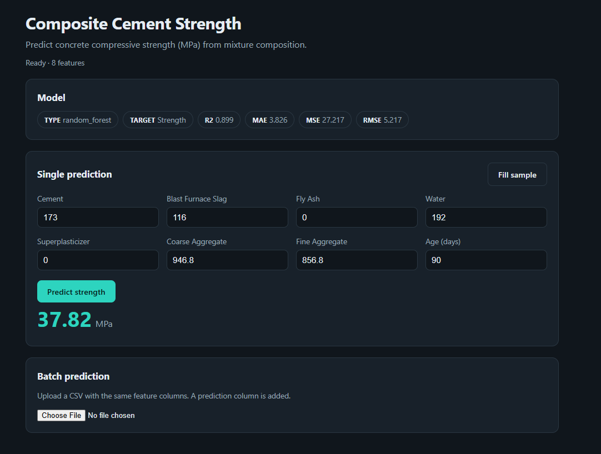

<div align="center">


<br />

**An end-to-end MLOps workflow for predicting concrete compressive strength from mixture composition.**

[Quick start](#quick-start) · [Structure](#project-structure) · [CLI](#cli-reference) · [Configuration](#configuration) · [API](#web-console--rest-api) · [Docker](#docker) · [Tests](#tests)

</div>

---

## Overview

The project trains a regression model on the UCI Concrete Compressive Strength
dataset and exposes it through a command line interface, a REST API and a small
web console.

| Feature | Description |
|---|---|
| **Stage-based pipeline** | `ingest → preprocess → train → evaluate → predict`, one module per stage |
| **Config-driven** | Paths, split, model type, hyperparameters, metrics and server settings live in `config.yaml` |
| **Three model types** | `decision_tree`, `random_forest`, `extra_trees` — all scikit-learn regressors |
| **Batch prediction** | Score any CSV from the CLI or the web console |
| **REST API + web console** | FastAPI backend with auto-generated docs and a no-build HTML/CSS/JS UI |
| **Docker** | One image, one compose service per stage plus a serving service |
| **Tests & CI** | pytest suite and a GitHub Actions workflow for tests, pipeline smoke test and image build |

On the included dataset the default random forest reaches about **0.90 R²**
with an RMSE of roughly **5.2 MPa** on the held-out test set.

---

## Project structure

```
MLOps_CompositeCementStrength_PredictionModel/
├── main.py                        # CLI entry point (one sub-command per stage)
├── config.yaml                    # single source of configuration
├── pyproject.toml                 # dependencies, packaging, pytest settings
├── Makefile                       # shortcuts for local and Docker workflows
├── Dockerfile                     # image definition (same as docker/Dockerfile)
├── .dockerignore  .gitignore
│
├── src/
│   ├── data_ingestion.py          # stage 1: load and validate the raw CSV
│   ├── data_preprocessing.py      # stage 2: clean, impute, split
│   ├── model_building.py          # stage 3: build and train the model
│   ├── model_evaluation.py        # stage 4: score the model on test data
│   ├── model_prediction.py        # stage 5: batch predictions
│   ├── api.py                     # FastAPI app and static frontend
│   └── utils.py                   # config, paths, logging, JSON and model I/O
│
├── frontend/                      # web console (plain HTML / CSS / JS)
│   ├── index.html
│   ├── css/style.css
│   └── js/app.js
│
├── data/                          # inputs and stage outputs (git-ignored)
│   ├── raw/                       # Concrete_Data.csv
│   ├── interim/                   # ingested.csv
│   └── processed/                 # train.csv, test.csv
├── artifacts/                     # everything the pipeline writes (git-ignored)
│   ├── models/                    # model.joblib, model_metadata.json
│   └── reports/                   # evaluation.json, prediction CSVs
├── logs/                          # mlops.log (git-ignored)
├── notebooks/
│   └── 01_eda.ipynb               # exploratory data analysis
├── scripts/run_pipeline.sh        # full pipeline in one command
├── tests/                         # conftest.py, test_pipeline.py, test_api.py
├── docker/                        # Dockerfile, docker-compose.yml
└── .github/workflows/ci.yml       # tests, pipeline smoke test, image build
```

---

## Quick start

Requires Python **3.12+**.

```bash
python -m venv .venv
source .venv/bin/activate          # Windows: .venv\Scripts\activate
pip install -e ".[dev]"

python main.py run-all             # ingest -> preprocess -> train -> evaluate
python main.py serve               # web console at http://127.0.0.1:8000
```

You can also use `uv`:

```bash
uv sync --extra dev
uv run main.py run-all
```



---

## CLI reference

```bash
python main.py [-c CONFIG] <command> [options]
```

| Command | Options | Description |
|---|---|---|
| `ingest` | | Load the raw CSV, validate it and save `data/interim/ingested.csv` |
| `preprocess` | | Clean, impute and split into `train.csv` / `test.csv` |
| `train` | | Train the configured model and save it under `artifacts/models/` |
| `evaluate` | | Score the saved model and write `artifacts/reports/evaluation.json` |
| `predict` | `--input F` `[--output F]` | Predict strength for every row of a CSV |
| `run-all` | | Run ingest, preprocess, train and evaluate |
| `serve` | `[--host H]` `[--port P]` | Start the web console and REST API |

`-c / --config` selects a different configuration file (default `config.yaml`).

Each stage reads the previous stage's output file, so any stage can be re-run
on its own. The same shortcuts are available through `make`:

| Target | Command |
|---|---|
| `make ingest` / `preprocess` / `train` / `evaluate` | matching CLI command |
| `make predict` | batch prediction on the raw dataset |
| `make run-all` | full pipeline |
| `make serve` | web console and API |
| `make test` | `pytest -q` |
| `make clean` | remove `artifacts/` and `.pytest_cache/` |
| `make docker-build` / `docker-run-all` / `docker-serve` | Docker equivalents |

---

## Configuration

All behaviour is controlled from `config.yaml`.

| Key | Default | Description |
|---|---|---|
| `project.name` | `composite-cement-strength-prediction` | Project name |
| `project.task` | `regression` | Task type |
| `data.path` | `data/raw/Concrete_Data.csv` | Input CSV |
| `data.target` | `Concrete compressive strength(MPa, megapascals) ` | Label column (note the trailing space) |
| `data.test_size` | `0.30` | Fraction held out for testing |
| `data.random_state` | `1` | Seed for the split |
| `preprocessing.handle_missing_values` | `true` | Fill missing feature values |
| `preprocessing.imputation_strategy` | `median` | `median` or `mean` |
| `preprocessing.remove_duplicates` | `true` | Drop duplicate rows |
| `model.type` | `random_forest` | Active model: `decision_tree`, `random_forest` or `extra_trees` |
| `model.params.<type>` | see file | Passed straight to the scikit-learn estimator |
| `artifacts.model_dir` | `artifacts/models` | Where the model and metadata are saved |
| `artifacts.report_dir` | `artifacts/reports` | Where evaluation and prediction files are written |
| `logging.level` / `logging.file` | `INFO` / `logs/mlops.log` | Console and file logging |
| `evaluation.metrics` | `r2`, `mae`, `mse`, `rmse` | Metrics computed after training |
| `serve.host` / `serve.port` | `127.0.0.1` / `8000` | Server address (`--host` / `--port` override) |

---

## Model artifacts

```
artifacts/
├── models/
│   ├── model.joblib              # trained scikit-learn model
│   └── model_metadata.json       # model type, params, features, target
└── reports/
    ├── evaluation.json           # metrics on the test set
    └── predictions.csv           # output of batch prediction
```

Each `train` run overwrites the model and metadata; the evaluation report is
rewritten by `evaluate`. Metadata is used by the API and `predict` to select
the exact feature columns, so column order in an input CSV does not matter.

---

## Web console & REST API

Start it with `python main.py serve` (or `make docker-serve`).

| URL | What you get |
|---|---|
| `http://127.0.0.1:8000/` | Web console |
| `http://127.0.0.1:8000/docs` | Interactive Swagger UI |
| `http://127.0.0.1:8000/openapi.json` | OpenAPI schema |

### Web console

- Model type and evaluation metrics
- **Single record** form generated from the model's feature names, with *Fill sample*
- **Batch** CSV upload with a preview table and downloadable predictions
- Automatic light / dark theme

### Endpoints

| Method | Path | Description |
|---|---|---|
| `GET` | `/api/health` | Service status and whether a model is available |
| `GET` | `/api/model` | Model type, target and evaluation metrics |
| `GET` | `/api/features` | Feature names the model expects |
| `GET` | `/api/sample` | One example row from the test set |
| `POST` | `/api/predict` | Predict for one or more rows |

Prediction request:

```bash
curl -X POST http://127.0.0.1:8000/api/predict \
  -H "Content-Type: application/json" \
  -d '{"rows": [{"<feature_1>": 1.0, "<feature_2>": 2.0}]}'
```

Response:

```json
{
  "predictions": [37.82]
}
```

Get the real feature names from `GET /api/features`, or a ready-made row from
`GET /api/sample`. Missing features return `400`, invalid values return `422`
and a missing model returns `404`.

### Production run

```bash
uvicorn --factory src.api:create_app --host 0.0.0.0 --port 8000 --workers 2
```

---

## Docker

`config.yaml`, `data/`, `artifacts/` and `logs/` are mounted into the
container, so outputs appear on your machine and configuration changes need no
rebuild.

| Compose service | Runs | Notes |
|---|---|---|
| `app` | any CLI command you pass | e.g. `run --rm app predict ...` |
| `ingest` | `ingest` | |
| `preprocess` | `preprocess` | |
| `train` | `train` | |
| `evaluate` | `evaluate` | |
| `run-all` | `run-all` | full pipeline |
| `predict` | `predict --input ... --output ...` | |
| `serve` | `serve --host 0.0.0.0 --port 8000` | publishes port **8000** |

```bash
make docker-build
make docker-run-all
make docker-serve                  # -> http://localhost:8000

# or with compose directly
docker compose -f docker/docker-compose.yml run --rm app run-all
docker compose -f docker/docker-compose.yml up serve
```

> `serve` needs a trained model, so run `run-all` first.

---

## Tests

```bash
make test        # or: pytest -q
```

| File | Covers |
|---|---|
| `tests/test_pipeline.py` | Every stage in order on a temporary dataset |
| `tests/test_api.py` | Frontend files, model info, single prediction, input validation, missing model |
| `tests/conftest.py` | Temporary dataset and config fixtures |

The GitHub Actions workflow (`.github/workflows/ci.yml`) runs the tests, the
full pipeline, a batch prediction smoke test and a Docker image build.

---

## Exploratory data analysis

`notebooks/01_eda.ipynb` walks through the raw dataset before modelling:

- data quality: shape, types, missing values, duplicates
- target distribution and feature distributions
- correlation matrix and strongest correlations with strength
- cement, superplasticizer and age effects; mean strength by curing age
- water–binder ratio analysis and IQR outlier counts

Install the plotting dependencies and open the notebook:

```bash
pip install -e ".[dev,notebooks]"
jupyter lab notebooks/01_eda.ipynb     # or open it in VS Code
```

Cells are already executed, so the plots and numbers are visible on GitHub.

---

## Data notes

- The target column name in `Concrete_Data.csv` ends with a space:
  `"Concrete compressive strength(MPa, megapascals) "`. Keep the exact name in
  `config.yaml`.
- Feature columns keep their long dataset names (units included). The web
  console shortens them for display only.
- To use another CSV, update `data.path` and `data.target` in `config.yaml`,
  make sure all features are numeric, then run `python main.py run-all`.

---

## Troubleshooting

| Message | Cause and fix |
|---|---|
| `Raw data not found: ...` | Check `data.path` in `config.yaml` |
| `Target column '...' not found` | Set `data.target` to the exact label column name |
| `Interim data not found` | Run `python main.py ingest` first |
| `Training data not found` | Run `python main.py preprocess` first |
| `No trained model found` | Run `python main.py train` first |
| `Unknown model type` | Set `model.type` to one of `decision_tree`, `random_forest`, `extra_trees` |
| `Port 8000 already in use` | `python main.py serve --port 8001` |
| Web console shows "Model not available" | Train a model, then refresh the page |
